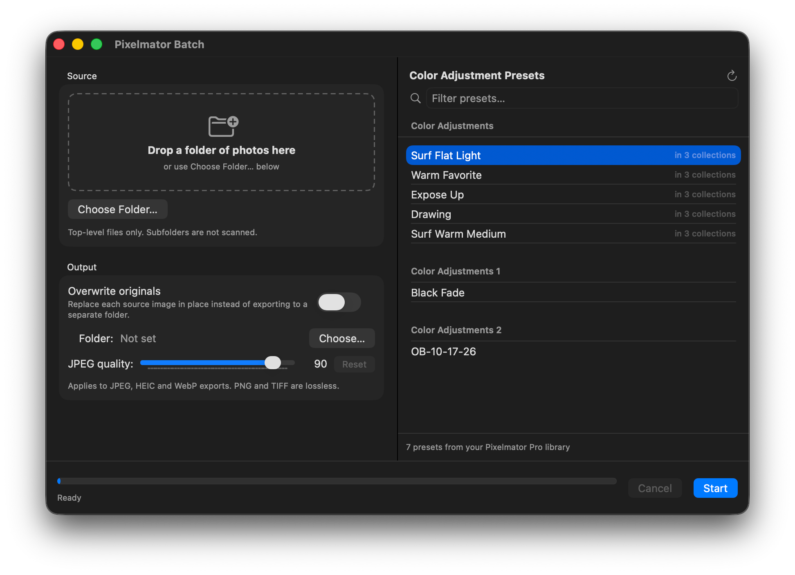

<p align="center">
  
</p>

# Pixelmator Batch

A small macOS app that applies a Pixelmator Pro **color adjustments preset** to every image in a folder.
It drives Pixelmator Pro over AppleScript (open → apply preset → export → close) and writes the results either to a separate output folder or over the originals.



## Requirements

- macOS 14 or later
- [Pixelmator Pro](https://www.pixelmator.com/pro/) installed (tested with 3.8)
- Xcode 16 or later to build

The app is **not sandboxed** and is not intended for the App Store. The first time a batch runs, macOS will ask for permission to let Pixelmator Batch control Pixelmator Pro.

## Using it

1. Drop a folder of photos onto the left pane, or click **Choose Folder…**. The pane shows the image count, the number of file types, and the total size. Only the top level of the folder is scanned.
2. Pick an output folder, or turn on **Overwrite originals** to replace the source files in place. Set the JPEG quality if you want something other than 90 (applies to JPEG, HEIC and WebP; PNG and TIFF are lossless).
3. Select a preset on the right. The list is read from your Pixelmator Pro preset library, so anything you've saved under *Color Adjustments → Custom* appears here. Use the refresh button after saving a new preset.
4. Click **Start**. If any destination file already exists (or overwrite is on) you'll be asked to confirm with Overwrite All / Skip Existing / Cancel. **Cancel** during a run stops after the current image.
5. When the run finishes a summary appears with an **Open Output Folder** button.

Supported inputs: JPEG, PNG, TIFF, HEIC, WebP. Each image is exported in its original format.

Every user action and every Pixelmator call is logged. Open **Window → Debug Log** (⇧⌘L) to view, filter, copy or save the log.

## How it works

- `PresetLibrary.swift` reads Pixelmator Pro's on-disk preset library (`~/Library/Group Containers/4R6749AYRE.com.pixelmator/…/Presets/Adjustments.library`). Pixelmator's scripting dictionary can apply a preset by name but cannot list them, so this is the only way to populate the picker.
- `PixelmatorBridge.swift` runs one `osascript` process per image so the UI never blocks and a stuck export can't take the app down. Each image is staged through a hidden folder in `~/Pictures` (see below), and the result is swapped into its real destination atomically once Pixelmator reports success, which is what makes overwriting originals safe.
- `BatchProcessor.swift` runs the loop, tracks progress and produces the summary.

### Notes on Pixelmator Pro's scripting behaviour (verified against 3.8)

- `apply color adjustments preset … name` **silently accepts unknown names** and does nothing. The app only offers names it found in the library, so this can't happen from the UI.
- Pixelmator's built-in presets (Vintage, Cinematic, …) are stored as "01", "02", … inside their collections and **cannot be applied by name** over AppleScript, so only user-created presets are listed.
- `open` returns `missing value` rather than an error for paths Pixelmator's sandbox can't read. The bridge treats that as a failure for that file.
- **Pixelmator is sandboxed, and whether it may read a file named in an AppleScript `open` depends on who sent the event.** Sent from a terminal with Full Disk Access it opens anything; sent from this app it fails for files under Desktop, Documents and Downloads with "Operation not permitted" (the "document is damaged" alert). Pixelmator does hold the `com.apple.security.assets.pictures.read-write` entitlement, so the bridge stages every image through `~/Pictures/.Pixelmator Batch Staging/`: the input is cloned in (instant on APFS, no extra space), Pixelmator opens and exports there, and the result is moved to the real destination. The staging folder is removed after each image, and any folder left behind by a crash is swept on the next launch.

### Headless self-test

```sh
open "build/Build/Products/Debug/Pixelmator Batch.app" --args --selftest <input image> <output path> "<preset name>"
```

Runs one image through the bridge under the app's own process identity (so sandbox and permission attribution match a real run) and writes a report to `~/Library/Logs/PixelmatorBatch-selftest.log`.

## Building

Open `Pixelmator Batch.xcodeproj` and run, or:

```sh
xcodebuild -project "Pixelmator Batch.xcodeproj" -scheme "Pixelmator Batch" -configuration Release build
```

The app icon is an Icon Composer bundle at `PixelmatorBatch/AppIcon.icon`; Xcode compiles it into the asset catalog and also emits a flat `.icns` fallback.

The project is set to sign to run locally. Set your team in *Signing & Capabilities* if you want a Developer ID build.
